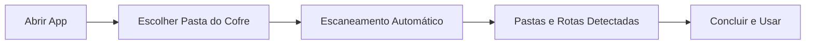
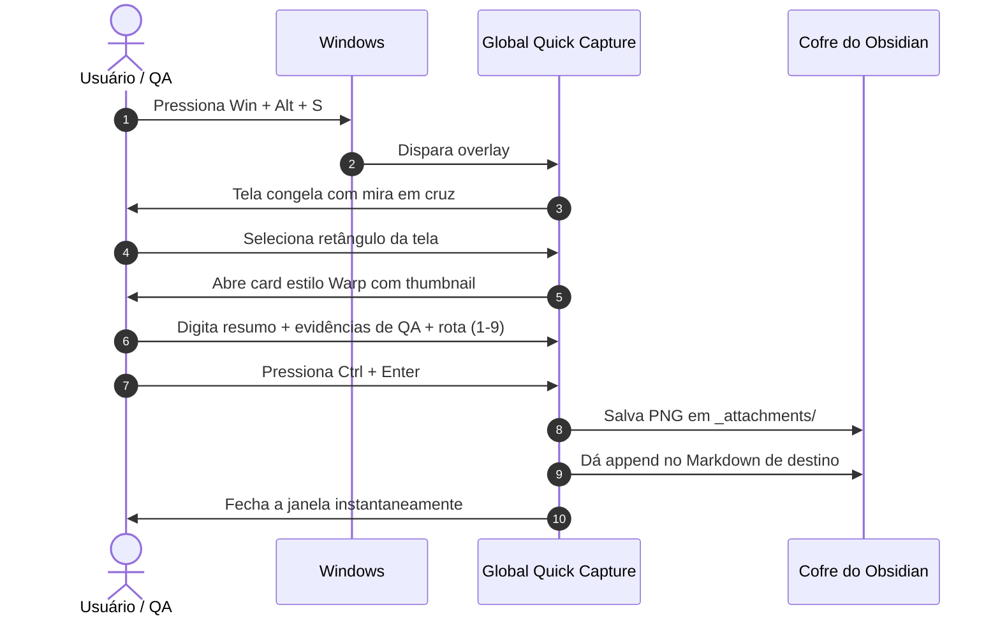

# Global Quick Capture

> Utilitário nativo para Windows inspirado no Raycast e Warp Terminal para captura rápida de tela e evidências de QA, com gravação direta no cofre do Obsidian.

[](https://github.com/Felipe-Belotto/global-quick-capture/releases/latest)
[](https://microsoft.com/windows)
[](https://tauri.app/)
[](https://react.dev/)
[](https://tailwindcss.com/)
[](LICENSE)

---

## Sumário

- [Como Baixar e Instalar](#-como-baixar-e-instalar)
- [Guia de Primeiro Uso](#-guia-de-primeiro-uso-onboarding)
- [Fluxo de Uso no Dia a Dia](#-fluxo-de-uso-no-dia-a-dia)
- [Principais Funcionalidades](#-principais-funcionalidades)
- [Formato de Saída no Obsidian](#-formato-de-sa%C3%ADda-no-obsidian)
- [Atalhos de Teclado](#-atalhos-de-teclado)
- [Configurações e Personalização](#-configura%C3%A7%C3%B5es-e-personaliza%C3%A7%C3%A3o)
- [Perguntas Frequentes (FAQ)](#-perguntas-frequentes-faq)
- [Desenvolvimento Local](#-desenvolvimento-local)
- [Arquitetura do Projeto](#-arquitetura-do-projeto)

---

## 📥 Como Baixar e Instalar

O aplicativo é distribuído como um instalador executável para Windows (`x64`).

### Passo 1: Download
Baixe a versão mais recente diretamente na página de lançamentos:
- **[Baixar Instalador Oficial (.exe)](https://github.com/Felipe-Belotto/global-quick-capture/releases/latest)**

### Passo 2: Instalação
1. Execute o arquivo baixado (ex: `global-quick-capture_0.1.0_x64-setup.exe`).
2. Conclua o assistente de instalação padrão do Windows.
3. O ícone da aplicação será adicionado ao **Menu Iniciar**, à **Área de Trabalho** e ficará ativo na **Bandeja do Sistema (perto do relógio)**.

> **Nota sobre o Windows SmartScreen**: Por ser um binário de código aberto sem certificado corporativo pago da Microsoft, o Windows pode exibir o aviso *"O Windows protegeu o seu computador"*. Basta clicar em **"Mais informações"** e em seguida em **"Executar assim mesmo"**.

---

## 🧭 Guia de Primeiro Uso (Onboarding)

Ao abrir o aplicativo pela primeira vez, o assistente de configuração automática será exibido:



1. **Selecione o Cofre**: Clique em **"Escolher Pasta do Cofre..."** e aponte para a raiz do seu Obsidian (ex: `C:\Users\seu-nome\Documents\MeuCofre`).
2. **Identificação Inteligente de Pastas**: O app lê a estrutura do seu cofre em tempo real (como nas IAs Claude e Cursor) e lista suas pastas (`Daily`, `Inbox`, `Projects/QA`, `Frontend`, etc.).
3. **Atalhos Automáticos**: O assistente sugere atalhos numéricos (`1`, `2`, `3`...) para cada pasta encontrada.
4. **Finalizar**: Clique em **"Concluir e Começar"**. O app ficará rodando silenciosamente na bandeja.

---

## 🔄 Fluxo de Uso no Dia a Dia



---

## ⚡ Principais Funcionalidades

### 1. Captura de Tela sem Conflitos
- Acionamento global via <kbd>Win + Alt + S</kbd> em qualquer tela do Windows.
- Mira em cruz com máscara escurecida e cálculo de dimensões em pixels em tempo real.
- Cancelamento imediato com <kbd>Esc</kbd>.

### 2. Card Flutuante Estilo Warp Terminal
- **Fundo Sólido e Profundo**: Paleta `#0f1117` com 96% de opacidade e efeito *blur*, sem vazamento de texto do fundo.
- **Autofocus Imediato**: Comece a digitar o resumo da captura assim que soltar o mouse.
- **Campo Especializado para QA**: Área de texto para descrição detalhada de passos de teste, comportamentos esperados e logs.
- **Roteamento Ágil via Teclado**: Teclas numéricas alternam o destino instantaneamente:
  - <kbd>1</kbd> Daily Note (`Daily/YYYY-MM-DD.md`)
  - <kbd>2</kbd> Inbox (`Inbox.md`)
  - <kbd>3</kbd> QA / Bugs (`Projects/QA/Bugs/`)
  - <kbd>4</kbd> a <kbd>9</kbd> Projetos personalizados

### 3. Integração Direta com o Sistema de Arquivos
- **Zero Plugins no Obsidian**: Não requer Obsidian aberto nem servidor HTTP local.
- Gravação direta via Rust (`std::fs`). O Obsidian detecta e recarrega os arquivos em tempo real.
- Imagens salvas como `.png` otimizado com timestamp (`clip-YYYYMMDD-HHmmss.png`).

---

## 📄 Formato de Saída no Obsidian

Cada captura confirmada é adicionada ao final do arquivo Markdown selecionado com sintaxe nativa Wiki-Link:

```markdown
### 21:40 - Botão de checkout não responde #qa #bug
![[clip-20261013-214012.png]]
> **QA / Observação**: Ao clicar em 'Pagar com PIX' na resolução 1440p, a requisição retorna status 422 e o modal fecha sem feedback visual.
```

---

## ⌨️ Atalhos de Teclado

| Tecla | Escopo | Ação |
| :--- | :--- | :--- |
| <kbd>Win + Alt + S</kbd> | Global (Sistema) | Abre o overlay de recorte sobre a tela ativa |
| <kbd>Esc</kbd> | Janela Ativa | Cancela o recorte ou fecha o modal sem salvar |
| <kbd>1</kbd> a <kbd>9</kbd> | Card de Captura | Seleciona o projeto ou nota de destino |
| <kbd>Tab</kbd> | Card de Captura | Alterna entre o campo de título e o campo de notas de QA |
| <kbd>Ctrl + Enter</kbd> | Card de Captura | Grava a nota no Obsidian e fecha o modal |

---

## ⚙️ Configurações e Personalização

Clique no **ícone de engrenagem** no cabeçalho do card ou no menu da bandeja para abrir o painel de configurações:

- **Pasta Raiz do Cofre**: Altere o caminho do seu cofre a qualquer momento via botão **"Procurar..."**.
- **Pasta de Anexos**: Personalize a pasta onde os arquivos `.png` são salvos (padrão: `_attachments`).
- **Atalho Global Customizado**: Altere a combinação de teclas para a de sua preferência (ex: `Alt+Shift+S`, `Super+Alt+N`, `Ctrl+Alt+S`).
- **Detectar Novas Pastas**: Botão de recarga que escaneia seu cofre para mapear novas pastas criadas recentemente no Obsidian.

O arquivo de configuração é mantido em formato JSON em:  
`%APPDATA%\global-quick-capture\config.json`

---

## ❓ Perguntas Frequentes (FAQ)

#### O Obsidian precisa estar aberto para a ferramenta funcionar?
**Não.** O app lê e grava os arquivos diretamente no disco do seu computador. Quando você abrir o Obsidian, todas as notas e recortes estarão perfeitamente organizados.

#### Quanto de memória o aplicativo consome?
Aproximadamente **30 a 40 MB de memória RAM** em modo de espera na bandeja, graças ao runtime nativo do Tauri v2 com Webview2.

#### Posso usar em múltiplos monitores?
**Sim.** O atalho identifica o monitor onde o cursor do mouse estiver ativo no momento do disparo.

#### Como desinstalar?
Pelo painel padrão do Windows: *Configurações > Aplicativos > Aplicativos Instalados > Global Quick Capture > Desinstalar*.

---

## 💻 Desenvolvimento Local

Caso queira contribuir ou compilar o projeto do zero:

### Requisitos
- [Node.js](https://nodejs.org/) v20+
- [Rust](https://www.rust-lang.org/) com o toolchain `x86_64-pc-windows-msvc`
- Microsoft C++ Build Tools (instalado via Visual Studio Installer)

### Comandos

```powershell
# Clonar o repositório
git clone https://github.com/Felipe-Belotto/global-quick-capture.git
cd global-quick-capture

# Instalar dependências do frontend
npm install

# Iniciar servidor de desenvolvimento com Hot Reload
npm run tauri dev

# Compilar executável e instalador final
npm run tauri build
```

---

## 📐 Arquitetura do Projeto

O desenvolvimento é estruturado através da documentação mantida no diretório [`docs/`](./docs):

- [`docs/00_PRD.md`](./docs/00_PRD.md) — Documento de requisitos de produto e métricas de sucesso.
- [`docs/01_ARCHITECTURE.md`](./docs/01_ARCHITECTURE.md) — Decisões de arquitetura, multi-janelas e comunicação IPC.
- [`docs/02_DATA_CONTRACTS.md`](./docs/02_DATA_CONTRACTS.md) — Esquemas de dados, tipagem TypeScript e contratos Rust.
- [`docs/03_ROADMAP.md`](./docs/03_ROADMAP.md) — Fila viva de execução com status de tarefas.
- [`docs/AGENT_GUIDELINES.md`](./docs/AGENT_GUIDELINES.md) — Protocolo de governança para agentes autônomos.

---

## 📜 Licença

Distribuído sob a licença [MIT](LICENSE).
