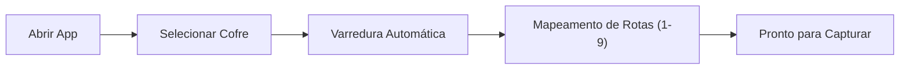

<div align="center">

# Global Quick Capture

**Snipping tool e captura rápida para Obsidian no Windows.**  
Inspirado na velocidade do Raycast e na estética refinada do Warp Terminal.

[](https://github.com/Felipe-Belotto/global-quick-capture/releases/tag/v0.1.0)
[-0ea5e9?style=flat-square&logo=windows&logoColor=white)](https://github.com/Felipe-Belotto/global-quick-capture/releases/download/v0.1.0/Global.Quick.Capture_0.1.0_x64-setup.exe)
[](https://tauri.app/)
[](https://react.dev/)
[](https://tailwindcss.com/)
[](LICENSE)

<br />

```
┌────────────────────────────────────────────────────────────────────────┐
│  [1] Daily Note   [2] Inbox   [3] QA / Bugs   [4] Frontend         ⚙  ✕ │
├────────────────────────────────────────────────────────────────────────┤
│  ┌──────────────┐  Resumo do recorte / Título do bug...                │
│  │              │  ─────────────────────────────────────────────────── │
│  │   [THUMB]    │  Observações de QA, passos de reprodução, logs...    │
│  │              │                                                      │
│  └──────────────┘                                                      │
│  Tags: #qa  #bug  #ui  #p1                                             │
├────────────────────────────────────────────────────────────────────────┤
│  ↳ Destino: Projects/QA/Bugs/2026-10-13_nota.md     [Salvar Ctrl+Enter]│
└────────────────────────────────────────────────────────────────────────┘
```

</div>

---

## O que o projeto resolve

Gravar notas visuais no Obsidian normalmente exige abrir o app, criar uma nova nota, colar o print e organizá-lo manualmente. 

O **Global Quick Capture** elimina esse atrito:
1. Pressione **`Win + Alt + S`** em qualquer lugar do Windows.
2. Arraste o mouse sobre a área que deseja recortar.
3. Digite o título, adicione notas detalhadas de QA e selecione a pasta de destino pelo teclado (`1`, `2`, `3`).
4. Pressione **`Ctrl + Enter`**: a imagem `.png` é gravada na pasta de anexos e a entrada formatada em Markdown é inserida no seu cofre instantaneamente.

Tudo roda nativamente em Rust via Tauri v2, com consumo de memória em torno de **30 a 40 MB** em segundo plano.

---

## Download e Instalação

| Tipo | Arquivo | Plataforma |
| :--- | :--- | :--- |
| **Instalador Oficial (.exe)** | [`Global.Quick.Capture_0.1.0_x64-setup.exe`](https://github.com/Felipe-Belotto/global-quick-capture/releases/download/v0.1.0/Global.Quick.Capture_0.1.0_x64-setup.exe) | Windows 10 / 11 (x64) |
| **Pacote MSI** | [`Global.Quick.Capture_0.1.0_x64_en-US.msi`](https://github.com/Felipe-Belotto/global-quick-capture/releases/download/v0.1.0/Global.Quick.Capture_0.1.0_x64_en-US.msi) | Windows 10 / 11 (x64) |

> [!NOTE]
> **Aviso do Windows SmartScreen**: Como o projeto é de código aberto e não possui um certificado digital pago da Microsoft, o Windows pode exibir um alerta de segurança na primeira execução. Basta clicar em **Mais informações** e selecionar **Executar assim mesmo**.

---

## Configuração Inicial (Onboarding)

Na primeira execução, o app abre uma tela de configuração guiada:



1. Clique em **Escolher Pasta do Cofre...** e selecione a pasta raiz do seu Obsidian (ex: `C:\Users\...\MeuCofre`).
2. O sistema escaneia o cofre automaticamente e identifica suas pastas (`Daily`, `Inbox`, `Projects/QA`, `Frontend`, etc.).
3. Atribua as pastas desejadas como rotas rápidas acionáveis pelo teclado (`1`, `2`, `3`).
4. Conclua o setup. O utilitário ficará ativo na bandeja do sistema, próximo ao relógio.

---

## Formato de Escrita no Markdown

Ao salvar uma captura, o arquivo de destino recebe o bloco formatado com data, hora, tags, referência à imagem em sintaxe Wiki-Link e bloco de anotações:

```markdown
### 21:40 - Modal de checkout fecha sem feedback #qa #bug
![[clip-20261013-214012.png]]
> **QA / Observação**: Ao clicar em 'Pagar com PIX' na resolução 1440p, a API responde 422 e o modal desaparece sem exibir o erro na tela.
```

- A imagem recortada é gravada em `_attachments/clip-YYYYMMDD-HHmmss.png` (ou na subpasta de assets definida para o projeto).
- O arquivo `.md` é atualizado via `append` nativo direto no disco. O Obsidian detecta e recarrega o conteúdo imediatamente.

---

## Mapeamento de Atalhos

| Atalho | Contexto | Descrição |
| :--- | :--- | :--- |
| `Win + Alt + S` | Global no Windows | Abre o overlay de recorte sobre qualquer janela |
| `Esc` | Overlay / Card | Cancela a seleção ou fecha o card sem salvar |
| `1` a `9` | Card de Captura | Seleciona o projeto ou nota de destino |
| `Tab` | Card de Captura | Alterna entre o campo de título e o campo de notas de QA |
| `Ctrl + Enter` | Card de Captura | Grava a nota no cofre e fecha a janela |

---

## Painel de Configurações

Acessível pelo ícone de engrenagem no card ou pelo menu de contexto na bandeja:

- **Pasta do Cofre**: Altere o caminho a qualquer momento através do seletor nativo do Windows.
- **Pasta de Anexos**: Defina a pasta padrão de imagens (padrão: `_attachments`).
- **Atalho Global**: Altere a combinação de disparo (ex: `Super+Alt+S`, `Alt+Shift+S`, `Super+Alt+N`).
- **Detectar Novas Pastas**: Re-escaneia o cofre para adicionar pastas criadas recentemente no Obsidian como novas rotas.

As configurações são persistidas em:
```
%APPDATA%\global-quick-capture\config.json
```

---

## Stack Tecnológica

| Camada | Ferramenta | Papel |
| :--- | :--- | :--- |
| **Runtime Desktop** | [Tauri v2](https://tauri.app/) | Janelas nativas sem bordas, atalhos de sistema e ícone de bandeja |
| **Backend Nativo** | [Rust](https://www.rust-lang.org/) | Operações em disco (`std::fs`), IPC e diálogo nativo de pastas (`rfd`) |
| **Frontend** | [React 19](https://react.dev/) + [Vite](https://vite.dev/) | Estrutura de componentes e estado |
| **Estilização** | [Tailwind CSS v4](https://tailwindcss.com/) | Interface escura profunda inspirada no Warp Terminal |
| **Ícones** | [Lucide React](https://lucide.dev/) | Iconografia consistente |
| **CI / CD** | [GitHub Actions](https://github.com/features/actions) | Compilação automática do instalador `.exe` em runner Windows |

---

## Compilação Local

```powershell
# 1. Clonar repositório
git clone https://github.com/Felipe-Belotto/global-quick-capture.git
cd global-quick-capture

# 2. Instalar dependências
npm install

# 3. Executar em modo desenvolvimento
npm run tauri dev

# 4. Gerar instalador local
npm run tauri build
```

---

## Licença

Distribuído sob a licença [MIT](LICENSE).
