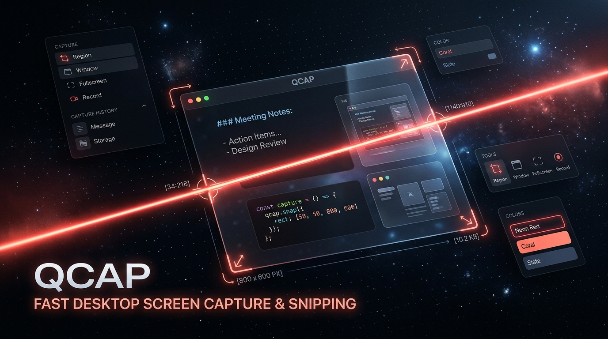
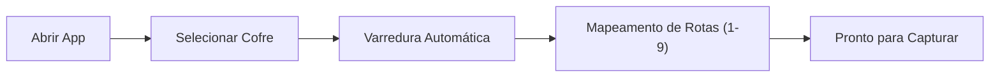

<div align="center">



# QCap

**Snipping tool e captura rápida para Obsidian no Windows.**  
Inspirado na velocidade do Raycast e na estética refinada do Warp Terminal.

[](https://github.com/Felipe-Belotto/global-quick-capture/releases/tag/v0.1.3)
[-0ea5e9?style=flat-square&logo=windows&logoColor=white)](https://github.com/Felipe-Belotto/global-quick-capture/releases/download/v0.1.3/Global.Quick.Capture_0.1.3_x64-setup.exe)
[](https://tauri.app/)
[](https://react.dev/)
[](https://tailwindcss.com/)
[](LICENSE)

<br />

```
┌────────────────────────────────────────────────────────────────────────┐
│  [1] Daily Note   [2] Inbox   [3] QA / Bugs   [4] Frontend         ⚙  ✕ │
├────────────────────────────────────────────────────────────────────────┤
│  ┌──────────────┐  Resumo do recorte / Título do bug...                │
│  │              │  ─────────────────────────────────────────────────── │
│  │   [THUMB]    │  Observações de QA, passos de reprodução, logs...    │
│  │              │                                                      │
│  └──────────────┘                                                      │
│  Tags: #qa  #bug  #ui  #p1                                             │
├────────────────────────────────────────────────────────────────────────┤
│  ↳ Destino: Projects/QA/Bugs/2026-10-13_nota.md     [Salvar Ctrl+Enter]│
└────────────────────────────────────────────────────────────────────────┘
```

</div>

---

## O que o projeto resolve

Gravar notas visuais no Obsidian normalmente exige abrir o app, criar uma nova nota, colar o print e organizá-lo manualmente. 

O **QCap** elimina esse atrito:
1. Pressione **`Win + Alt + S`** em qualquer lugar do Windows.
2. Arraste o mouse sobre a área que deseja recortar.
3. Digite o título, adicione notas detalhadas de QA e selecione a pasta de destino pelo teclado (`1`, `2`, `3`).
4. Pressione **`Ctrl + Enter`**: a imagem `.png` é gravada na pasta de anexos e a entrada formatada em Markdown é inserida no seu cofre instantaneamente.

Tudo roda nativamente em Rust via Tauri v2, com consumo de memória em torno de **30 a 40 MB** em segundo plano.

---

## Download e Instalação

### Opção 1: Download Direto (Releases Oficiais)

| Tipo | Arquivo | Plataforma | Link |
| :--- | :--- | :--- | :--- |
| **Instalador Oficial (.exe)** | `Global.Quick.Capture_0.1.3_x64-setup.exe` | Windows 10 / 11 (x64) | [Baixar .exe](https://github.com/Felipe-Belotto/global-quick-capture/releases/download/v0.1.3/Global.Quick.Capture_0.1.3_x64-setup.exe) |
| **Pacote MSI** | `Global.Quick.Capture_0.1.3_x64_en-US.msi` | Windows 10 / 11 (x64) | [Baixar .msi](https://github.com/Felipe-Belotto/global-quick-capture/releases/download/v0.1.3/Global.Quick.Capture_0.1.3_x64_en-US.msi) |
| **Artefato da Action (CI)** | `windows-installer.zip` | Windows 10 / 11 (x64) | [Acessar Builds no GitHub Actions](https://github.com/Felipe-Belotto/global-quick-capture/actions) |

---

### Opção 2: Instalação Rápida via PowerShell (Recomendado - Sem bloqueio de navegador)

Se o navegador bloquear o download por reputação, você pode baixar e iniciar a instalação em 1 linha no **PowerShell**:

```powershell
irm https://github.com/Felipe-Belotto/global-quick-capture/releases/download/v0.1.3/Global.Quick.Capture_0.1.3_x64-setup.exe -OutFile "$env:TEMP\setup.exe"; Unblock-File "$env:TEMP\setup.exe"; Start-Process "$env:TEMP\setup.exe"
```

---

### 🛡️ Como liberar o download e a instalação no Windows

Por ser um projeto open-source independente sem certificado comercial pago da Microsoft (*Code Signing Certificate*), os navegadores e o Windows SmartScreen podem emitir alertas preventivos:

#### 1. Se o navegador (Edge ou Chrome) disser "Arquivo suspeito / bloqueado":
- **Microsoft Edge**:
  1. Passe o cursor sobre o item na lista de downloads e clique no ícone **`...`** (Três pontos).
  2. Selecione **Manter** (*Keep*).
  3. Na janela seguinte, clique em **Mostrar mais** (*Show more*) e depois em **Manter mesmo assim** (*Keep anyway*).
- **Google Chrome**:
  1. Pressione `Ctrl + J` para abrir a página de Downloads.
  2. Localize o instalador e clique em **Baixar arquivo suspeito** (ou **Manter arquivo perigoso**).

#### 2. Se baixou o arquivo `.zip` da aba GitHub Actions:
- Arquivos baixados diretamente da aba *Actions* vêm com a flag de zona web do Windows.
- Clique com o botão direito no arquivo `.zip` (ou no `.exe` extraído) > **Propriedades** > marque a caixa **Desbloquear** (*Unblock*) no canto inferior > **Aplicar** / **OK**.
- Ou no PowerShell: `Unblock-File .\Global.Quick.Capture_0.1.0_x64-setup.exe`.

#### 3. Na primeira execução (Alerta do Windows SmartScreen):
- Quando a janela azul *"O Windows protegeu o seu computador"* aparecer:
  1. Clique no link textual **"Mais informações"** (*More info*).
  2. Clique no botão **"Executar assim mesmo"** (*Run anyway*).

---

## Configuração Inicial (Onboarding)

Na primeira execução, o app abre uma tela de configuração guiada:



1. Clique em **Escolher Pasta do Cofre...** e selecione a pasta raiz do seu Obsidian (ex: `C:\Users\...\MeuCofre`).
2. O sistema escaneia o cofre automaticamente e identifica suas pastas (`Daily`, `Inbox`, `Projects/QA`, `Frontend`, etc.).
3. Atribua as pastas desejadas como rotas rápidas acionáveis pelo teclado (`1`, `2`, `3`).
4. Conclua o setup. O utilitário ficará ativo na bandeja do sistema, próximo ao relógio.

---

## Formato de Escrita no Markdown

Ao salvar uma captura, o arquivo de destino recebe o bloco formatado com data, hora, tags, referência à imagem em sintaxe Wiki-Link e bloco de anotações:

```markdown
### 21:40 - Modal de checkout fecha sem feedback #qa #bug
![[clip-20261013-214012.png]]
> **QA / Observação**: Ao clicar em 'Pagar com PIX' na resolução 1440p, a API responde 422 e o modal desaparece sem exibir o erro na tela.
```

- A imagem recortada é gravada em `_attachments/clip-YYYYMMDD-HHmmss.png` (ou na subpasta de assets definida para o projeto).
- O arquivo `.md` é atualizado via `append` nativo direto no disco. O Obsidian detecta e recarrega o conteúdo imediatamente.

---

## Mapeamento de Atalhos

| Atalho | Contexto | Descrição |
| :--- | :--- | :--- |
| `Win + Alt + S` | Global no Windows | Abre o overlay de recorte sobre qualquer janela |
| `Esc` | Overlay / Card | Cancela a seleção ou fecha o card sem salvar |
| `1` a `9` | Card de Captura | Seleciona o projeto ou nota de destino |
| `Tab` | Card de Captura | Alterna entre o campo de título e o campo de notas de QA |
| `Ctrl + Enter` | Card de Captura | Grava a nota no cofre e fecha a janela |

---

## Painel de Configurações

Acessível pelo ícone de engrenagem no card ou pelo menu de contexto na bandeja:

- **Pasta do Cofre**: Altere o caminho a qualquer momento através do seletor nativo do Windows.
- **Pasta de Anexos**: Defina a pasta padrão de imagens (padrão: `_attachments`).
- **Atalho Global**: Altere a combinação de disparo (ex: `Super+Alt+S`, `Alt+Shift+S`, `Super+Alt+N`).
- **Detectar Novas Pastas**: Re-escaneia o cofre para adicionar pastas criadas recentemente no Obsidian como novas rotas.

As configurações são persistidas em:
```
%APPDATA%\qcap\config.json
```

---

## Stack Tecnológica

| Camada | Ferramenta | Papel |
| :--- | :--- | :--- |
| **Runtime Desktop** | [Tauri v2](https://tauri.app/) | Janelas nativas sem bordas, atalhos de sistema e ícone de bandeja |
| **Backend Nativo** | [Rust](https://www.rust-lang.org/) | Operações em disco (`std::fs`), IPC e diálogo nativo de pastas (`rfd`) |
| **Frontend** | [React 19](https://react.dev/) + [Vite](https://vite.dev/) | Estrutura de componentes e estado |
| **Estilização** | [Tailwind CSS v4](https://tailwindcss.com/) | Interface escura profunda inspirada no Warp Terminal |
| **Ícones** | [Lucide React](https://lucide.dev/) | Iconografia consistente |
| **CI / CD** | [GitHub Actions](https://github.com/features/actions) | Compilação automática do instalador `.exe` em runner Windows |

---

## Design System & Guia de UI/UX

O projeto conta com um documento interativo standalone de Design System contendo todas as telas, tokens, micro-interações e laboratório de estados para refatoração visual e melhoria contínua de UX:

- **Acesse o arquivo**: Abra diretamente no seu navegador [`docs/design-system.html`](docs/design-system.html) ou acerte a rota `/design-system.html` com o Vite em execução.
- **Conteúdo incluído**:
  - 🖥️ **Showcase de Telas**: Quick Capture Card, Snipping Tool Overlay (com simulação de recorte por drag), Settings Modal e Onboarding Wizard.
  - 🖼️ **Visão Panorama (Canvas)**: Comparativo de layout de todas as interfaces.
  - 🎨 **Design Tokens**: Paleta completa de cores (com clique para copiar HEX), tipografia mono/sans e componentes atômicos.
  - 💡 **Roadmap de UX**: Diagnóstico e sugestões para elevar a experiência visual (micro-feedbacks, animações de fechamento, anotações rápidas).

---

## Compilação Local

```powershell
# 1. Clonar repositório
git clone https://github.com/Felipe-Belotto/global-quick-capture.git
cd global-quick-capture

# 2. Instalar dependências
npm install

# 3. Executar em modo desenvolvimento
npm run tauri dev

# 4. Gerar instalador local
npm run tauri build
```

---

## Licença

Distribuído sob a licença [MIT](LICENSE).
